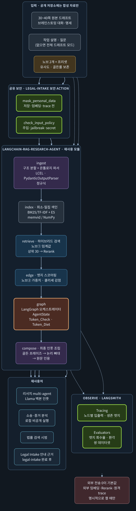
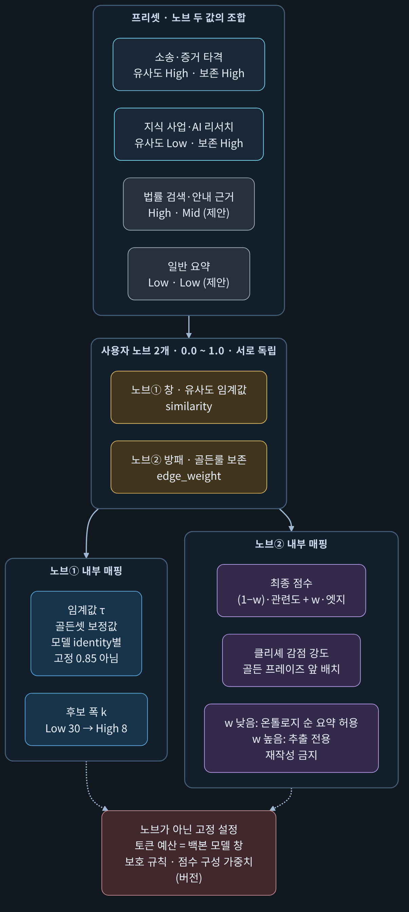
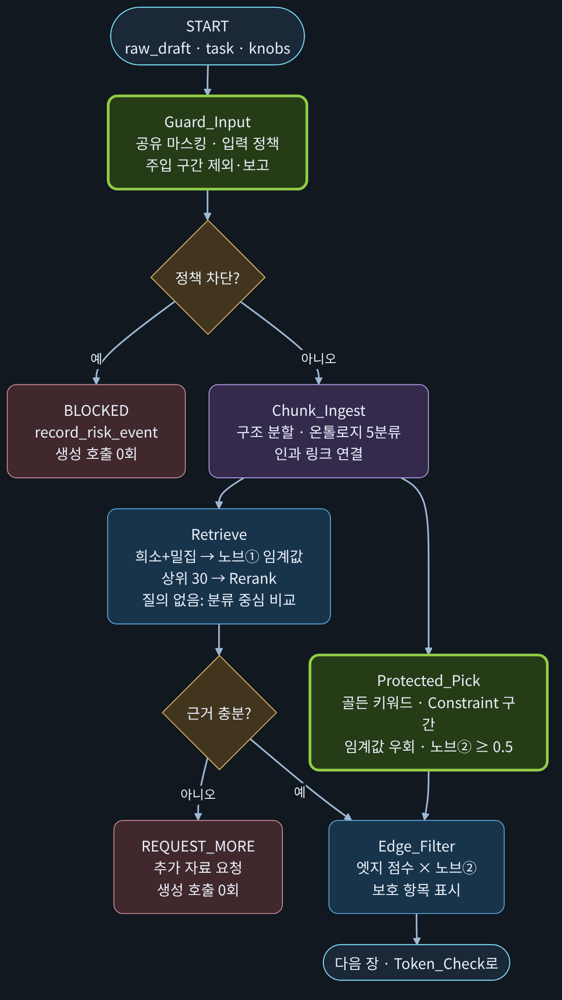
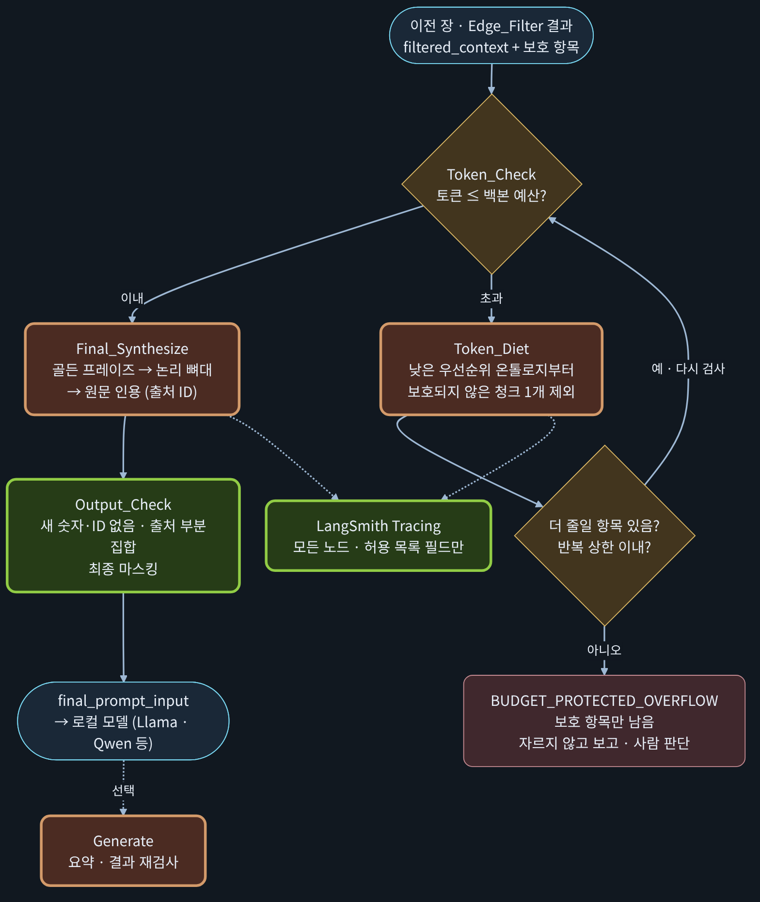
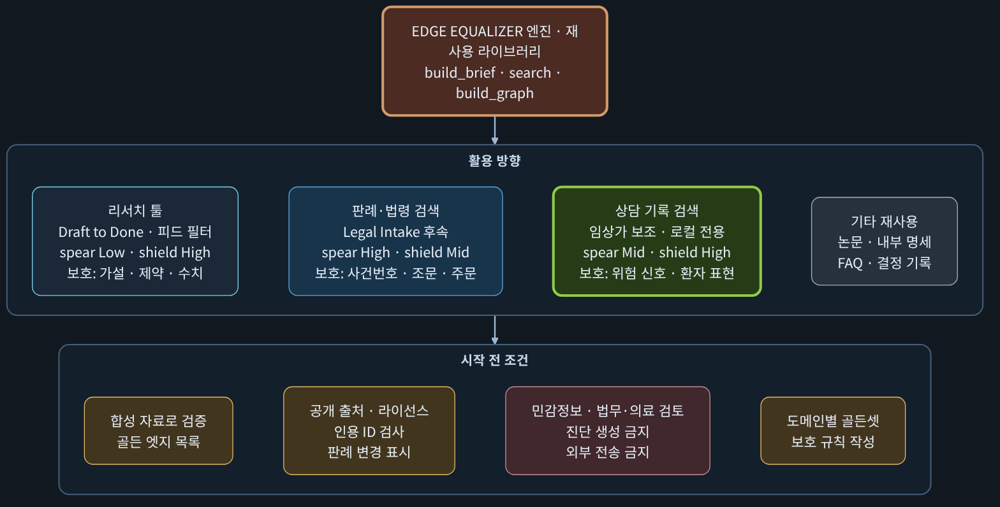

# langchain-rag-research-agent

**재사용 가능한 검색·브리프 모듈: 하이브리드 검색, 엣지 보존 "이퀄라이저", 그리고 긴 드래프트를 작은 로컬 모델용으로 줄일 때 작성자의 독창적 아이디어를 지키는 LangGraph 파이프라인.**

[English README](README.md) · [설계 정본](docs/DESIGN.ko.md) · [설계 검수 보고서](docs/DESIGN_REVIEW.ko.md) · [공부 가이드 (다크 PDF)](docs/EQUALIZER_STUDY_DARK.pdf)

> **상태: 설계 v1.0 확정(결정 D1~D7 확정, 2026-11-09), 구현 전.** 정본은 [docs/DESIGN.ko.md](docs/DESIGN.ko.md)입니다. 최상위 원칙 P0: 모든 기능은 분리 가능한 모듈로 만듭니다. 저장소 이름은 `python-memvid-guardrail`에서 변경하는 중이며, 이전의 하이브리드(Spring Boot + FastAPI + memvid) 내용은 [`docs/legacy/`](docs/legacy)에 보존돼 있고 [spring-fastapi-async-refactor](https://github.com/ai-agent-orchestrator/spring-fastapi-async-refactor)로 옮길 예정입니다.
> 현재 있는 것: E5 + memvid 검색 평가(합성 자료로 **실측**), 패키지 뼈대, 긴 프롬프트 브리프 시제품(가짜 임베더). **Edge Equalizer 자체는 설계 단계이며 구현 전이고, 실제 Llama·Qwen으로 요약 품질을 잰 결과는 아직 없습니다.** 아래 모든 숫자에 *실측*, *시제품*, *예시* 중 하나를 표시했습니다.

## 왜 필요한가

30~40쪽 브레인스토밍 드래프트에는 **엣지 문장**(독창적 가설, 구체 수치, 인과, 제약)과 **클리셰 문장**(교과서식 일반론)이 섞여 있습니다. 통째로 모델에 넣으면 컨텍스트 창에 걸리고, 긴 입력의 중간을 덜 활용하는 경향이 있으며, 요약은 가장 흔한 표현으로 수렴해 **엣지부터 사라집니다.**

이 모듈은 모델 앞에 놓입니다. 구조대로 나누고, 키워드와 의미로 찾고, 독창성 점수를 매기고, 버리면 안 되는 것을 보호하고, 모델 예산에 맞춰 줄입니다. **조용히 자르지 않습니다.**

## Edge Equalizer(가칭): 노브 2개

| 노브 | 뜻 | High | Low |
| --- | --- | --- | --- |
| ① 창: 유사도 임계값 | 후보를 얼마나 넓게 모으나 | 정밀, 팩트 중심 | 넓은 탐색 |
| ② 방패: 골든룰 엣지 가중치 `w` | 독창적 엣지를 얼마나 지키나 | 추출 전용, 클리셰 삭감, 골든 프레이즈 우선 | 온톨로지 순서의 읽기 쉬운 요약 |

`최종 점수 = (1 − w) · 리랭크 관련도 + w · 엣지 점수`

| 프리셋 | 창 | 방패 | 용도 |
| --- | --- | --- | --- |
| 소송·증거 타격 | High | High | 정확한 팩트만 고르고 미묘한 정황 보존 |
| 지식 사업·AI 리서치 | Low | High | 넓게 탐색하되 고유한 설계 사상 보존 |
| 법률 검색 (제안) | High | Mid | 정확한 근거, 핵심 인용 보호 |
| 일반 요약 (제안) | Low | Low | 가벼운 읽기용 |

노브가 아닌 값(토큰 예산, 보호 규칙, 점수 가중치, 감량 순서)은 **버전으로 고정된 설정**이라 결과를 항상 설명할 수 있습니다.

검수에서 정한 것 (자세한 내용은 [DESIGN_REVIEW](docs/DESIGN_REVIEW.ko.md)):
- 유사도 임계값은 0.85 고정이 아니라 **임베딩 모델별로 골든셋에서 보정**합니다. 실측 E5 점수는 좁은 구간에 모입니다(정답 1위 중 최저 0.787).
- **보호 후보 경로**: 골든 키워드·제약 구간이 노브①을 건너뛰어 두 노브가 실제로 독립입니다.
- 리랭커는 관련도만 재고, **클리셰 제거는 별도의 엣지 점수**가 합니다(희소성, 골든 프레이즈, 구체성, 인과 표지, 온톨로지 우선순위, 클리셰 감점).
- "유실 0"이 아니라 **"보호 항목 탈락 0"과 골든 엣지 회수율(n/총수)을 측정**합니다.

## 파이프라인

LangGraph 노드: `Guard_Input → Chunk_Ingest → Retrieve / Protected_Pick → Edge_Filter → Token_Check ⇄ Token_Diet → Final_Synthesize → Output_Check`

- 하이브리드 검색: BM25/TF-IDF + 로컬 다국어 E5 벡터를 RRF로 합쳐 상위 30개, 로컬 리랭커(기본 BGE).
- 온톨로지 5분류: `Core_Hypothesis`, `Tech_Architecture`, `Market_Positioning`, `Constraint_Guardrail`, `Action_Item` (+ 내부용 `Unclassified`, 삭제하지 않음). 파서는 위치만 표시하고 글을 고치지 않습니다.
- 인과 링크(`causes`, `supports`, `contradicts`, `supersedes`)로 대체된 결정이 현재 결정보다 앞서지 않게 합니다.
- Token Diet는 보호되지 않은 구간을 정해진 순서로 제외합니다. 보호 항목만으로 예산을 넘으면 자르지 않고 **`BUDGET_PROTECTED_OVERFLOW`로 멈춥니다.**
- 근거가 없으면 **생성 호출 0회**.

## 보안·개인정보

- **기본은 로컬**: 임베딩·리랭커·생성 모델이 기기 안에서 돌고, 외부 공급자는 인터페이스 뒤에서 실행 단위로만 켜며 소송 프리셋에서는 금지합니다.
- **마스킹·입력 정책은 공유**: [legal-intake-fastapi-lab](https://github.com/ai-agent-orchestrator/legal-intake-fastapi-lab)의 보안 action이 기준(canonical)입니다. 이 저장소는 규약과 시험용 가짜 구현만 둡니다.
- 지시 블록과 자료 블록 분리, 구간별 간접 주입 검사, 자료에 없는 숫자·날짜·ID를 만들거나 주지 않은 출처 ID를 인용하면 출력 거절.
- LangSmith 추적은 **서비스 코드에서 꺼 두고**, 합성·마스킹 자료 평가에서만 허용 목록 필드로 씁니다.
- 이 공개 저장소에는 **합성 자료만** 둡니다.

## 오픈소스 모델 (Llama 등)

생성·임베딩·리랭커는 인터페이스라서 엔진을 건드리지 않고 로컬 모델을 바꿔 끼울 수 있습니다. 기대하는 품질 향상은 더 큰 모델이 아니라 **더 좋은 입력**(예산에 맞춤, 엣지 우선, 추출 전용, 출처 표기)에서 나오며, 이는 **가설**입니다. 다섯 기준선(앞부분 자르기, 글자 수 청킹 RAG, 모델 직접, 선택적 Claude 직접, 이 파이프라인)과 골든 엣지 회수율로 측정합니다. Qwen 계열은 소유자 결정 전까지 기본 범위에서 제외합니다.

## 측정한 것과 아닌 것

| 항목 | 상태 | 근거 |
| --- | --- | --- |
| E5 + memvid 검색 | **실측** | 합성 10문서/30청크: 비교 세트 1위 적중 키워드 12/14 대 벡터 14/14, 확인 세트 5/6 대 6/6, 질의 임베딩 CPU 약 0.18~0.20초, 검색 2ms 미만 |
| 브리프 시제품 (Draft PR) | **시제품** | 가짜 임베더, 합성 41.6쪽: 회수율 앞부분 0.0, BM25 0.467, 벡터 0.445, 혼합 0.943 |
| 온톨로지 파서, 노브 2개, 엣지 점수, 보호 경로, Token Diet | 설계 | 검수 완료, 구현 전 |
| 실제 Llama·Qwen 요약 품질 | 미실행 | M5 예정 |

합성 자료이고 표본이 작아서 증거가 아니라 경향입니다.

## 재사용 방향

리서치 툴(Draft to Done), Legal Intake의 공개 판례·법령 검색, 임상가용 상담 기록 검색, 논문·명세 검색. 뒤의 둘은 가장 민감해서 법률·임상 검토, 로컬 전용, 진단·법률 판단 생성 금지, 합성 자료로만 개발이 필요합니다. 자세한 내용은 공부 가이드를 보세요.

## 관련 저장소

| 저장소 | 역할 |
| --- | --- |
| [legal-intake-fastapi-lab](https://github.com/ai-agent-orchestrator/legal-intake-fastapi-lab) | 원래 intake 설계, 보안 9개, 마케팅 강화(API 11개 이하), 마스킹의 기준 |
| [spring-fastapi-async-refactor](https://github.com/ai-agent-orchestrator/spring-fastapi-async-refactor) | Spring Boot 제어 + FastAPI + memvid 하이브리드 (이 저장소에서 이전 예정) |
| [ai-multi-agent-orchestration](https://github.com/ai-agent-orchestrator/ai-multi-agent-orchestration) | 허브: 멀티 에이전트 2개와 리서치 하네스 |

## 로드맵

M0–M1 패키지 뼈대·검색, 여기서 B02b 재현 · M2 골든셋 임베딩 모델 비교 · M3–M4 공유 보안, 그래프·추적, 외부 전송 0 시험 · **M5 Equalizer 핵심(온톨로지 파서, 노브 2개, 엣지 점수, 보호 경로, Token Diet)을 실제 로컬 모델로 평가** · M6 리서치 툴 그림자 비교 · M7 공개·합성 자료로 법률 검색 시범.

## 문서

[DESIGN_REVIEW.ko.md](docs/DESIGN_REVIEW.ko.md) · [MODULE_DESIGN.ko.md](docs/MODULE_DESIGN.ko.md) · [공부 가이드 PDF](docs/EQUALIZER_STUDY_DARK.pdf) · [다이어그램 원본](docs/diagrams) · [이전 하이브리드 README](docs/legacy)
