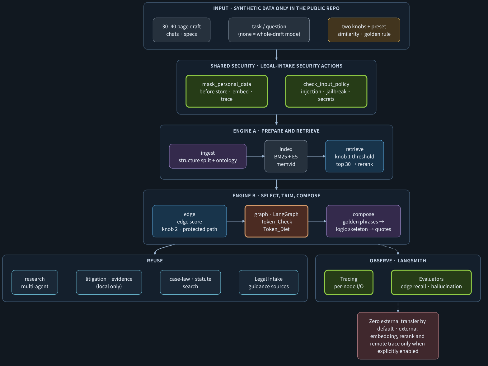
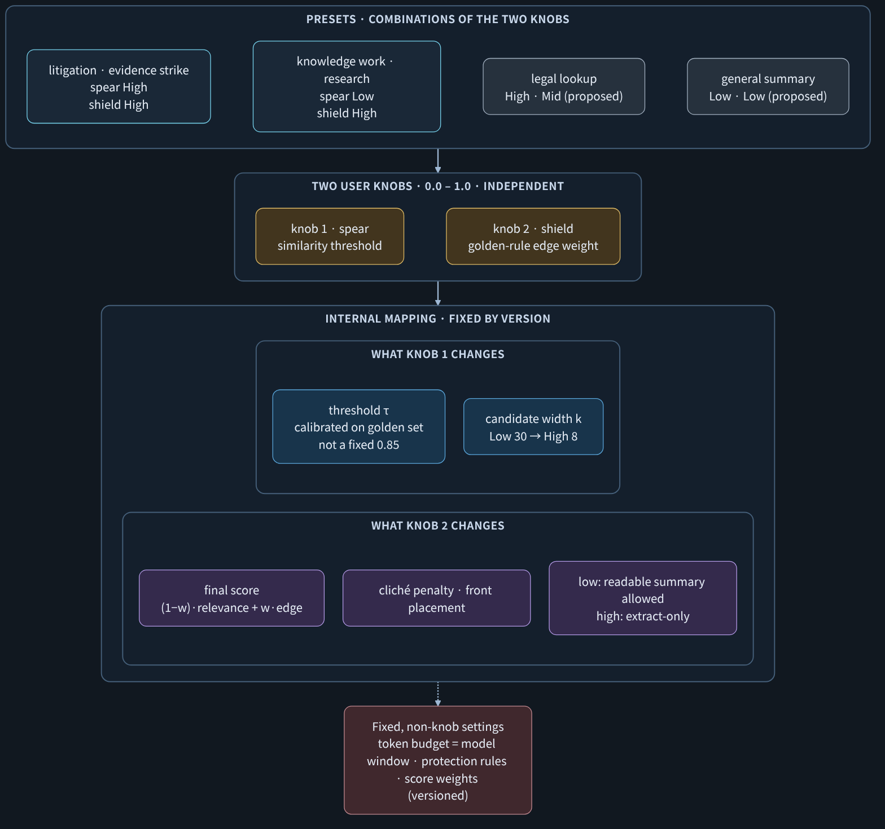
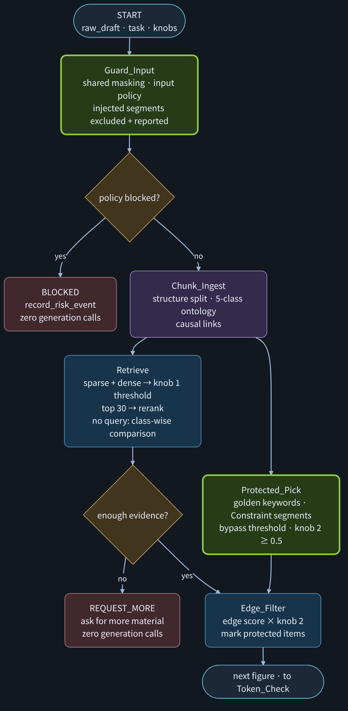
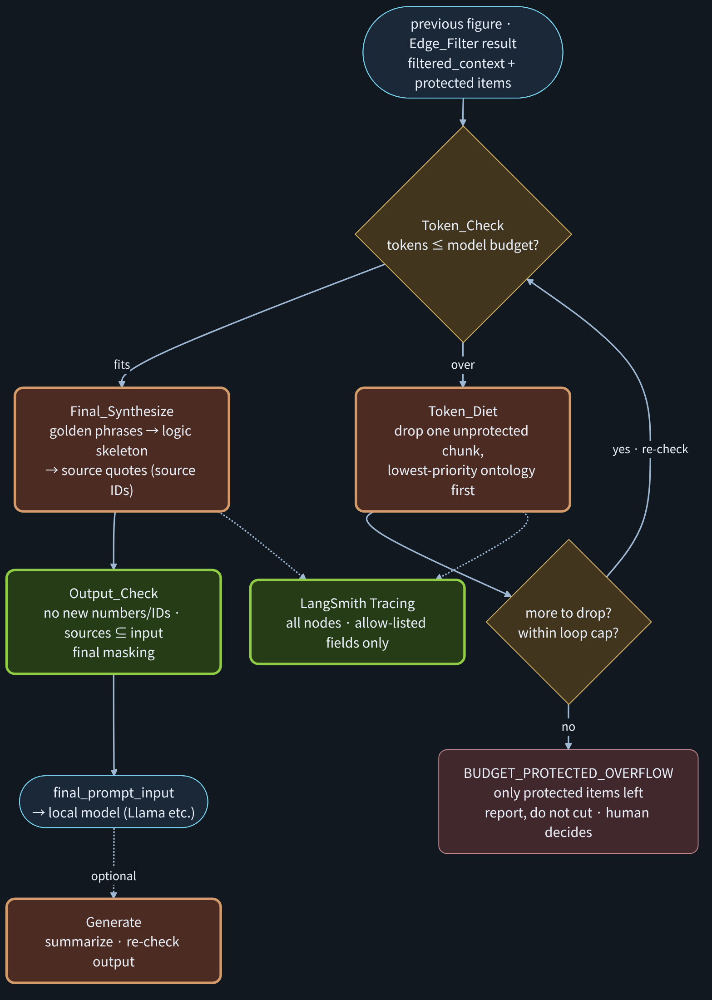
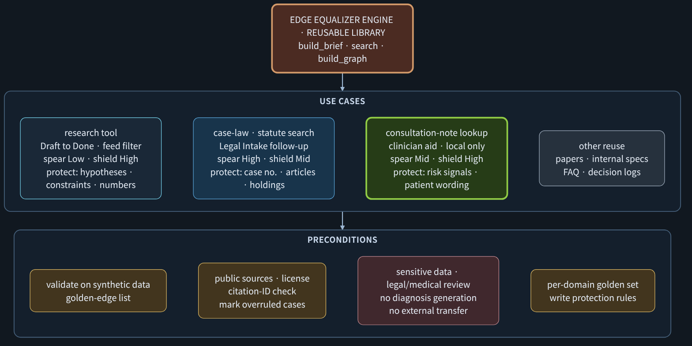

# langchain-rag-research-agent

**A reusable search and brief-building module: hybrid retrieval, an edge-preserving "equalizer", and a LangGraph pipeline that keeps an author's original ideas intact when a long draft is shrunk for a small local model.**

[한국어 README](README.ko.md) · [Design (ko)](docs/DESIGN.ko.md) · [Design review](docs/DESIGN_REVIEW.ko.md) · [Study guide (dark PDF)](docs/EQUALIZER_STUDY_DARK.pdf)

## Design change, 2026-11-10: control flow moves onto LangGraph rails

> **However precise the similarity search and golden rules are, a one-way LCEL chain or a fixed ReAct agent tangles the moment a research run needs 2–3 re-searches or error handling, and its token cost runs away. That is a problem of the path, not of the parts.**

```text
START → classify ──research──→ [ RAG node: search → evidence gate → answer ] ──route_by_cost_and_health──→ finish → END
           │                                    ├──retry (transient failure, ≤ 3 loops)──→ RAG node
           └──smalltalk──→ finish               └──kill (loop limit / cost limit / node error)──→ END
```

- **The RAG components are unchanged** and run as one isolated LangGraph node.
- **Retries, branches, stops and cost limits are decided by edges and state**: pure-Python route functions, with counters accumulated in state.
- New design decision **D13** and principle **P1** in [the design doc](docs/DESIGN.ko.md). Code: `rag/guardrail_graph.py`. Details: [below](#langgraph-guardrail-added-2026-11-10) and [docs/LANGGRAPH_GUARDRAIL.ko.md](docs/LANGGRAPH_GUARDRAIL.ko.md).
- Not yet inside the rail: the E2 re-search loop still has its own retry budget (next step).

> **Status: design v1.0 confirmed (decisions D1–D7 settled, 2026-11-09); implementation not started.** The authoritative design is [docs/DESIGN.ko.md](docs/DESIGN.ko.md) (Korean). Design principle P0: every feature is built as a separable module. This repository was formerly named `python-memvid-guardrail` (old URLs redirect); its former hybrid (Spring Boot + FastAPI + memvid) content now lives in [spring-fastapi-async-refactor/docs/hybrid](https://github.com/ai-agent-orchestrator/spring-fastapi-async-refactor/tree/main/docs/hybrid).
> What exists today: an E5 + memvid retrieval evaluation (measured on synthetic data), a package skeleton, and a long-prompt brief prototype (fake embedder). **The Edge Equalizer itself is a design, not yet an implementation, and no real Llama or Qwen summarization quality has been measured.** Every number below is labelled *measured*, *prototype* or *example*.



## Why

A 30–40 page brainstorming draft mixes **edge sentences** (an original hypothesis, a concrete number, a cause-and-effect, a constraint) with **cliché sentences** (textbook generalities). Feeding the draft whole into a small model hits the context window, the model tends to under-use the middle of long inputs, and summaries drift toward the most common phrasing, so the edge is the first thing lost.

This module sits in front of the model. It splits the draft by structure, retrieves with keywords and meaning, scores each segment for originality, protects what must never be dropped, and trims to the model's budget, **without silently truncating**.

## The Edge Equalizer (working name): two knobs



| Knob | Meaning | High | Low |
| --- | --- | --- | --- |
| 1. Spear: similarity threshold | how wide the candidate net is | precise, fact-focused | broad exploration |
| 2. Shield: golden-rule edge weight `w` | how strongly original edges are kept | extract-only, clichés cut, golden phrases first | readable ontology-ordered summary |

`final_score = (1 − w) · rerank_relevance + w · edge_score`

| Preset | Spear | Shield | Use |
| --- | --- | --- | --- |
| Litigation / evidence strike | High | High | find exact facts, preserve subtle detail |
| Knowledge work / AI research | Low | High | explore widely, keep the author's own ideas |
| Legal lookup (proposed) | High | Mid | precise sources, key citations protected |
| General summary (proposed) | Low | Low | light reading |

Everything that is not a knob (token budget, protection rules, score weights, diet order) is a **versioned fixed configuration**, so a result can always be explained.

Design decisions made in review (details in [DESIGN_REVIEW](docs/DESIGN_REVIEW.ko.md)):
- The similarity threshold is **calibrated per embedding model on a golden set**, not fixed at 0.85. Measured E5 scores sit in a narrow band (lowest correct top-1 = 0.787).
- A **protected-candidate path** lets golden-keyword and constraint segments bypass knob 1, so the two knobs are genuinely independent.
- A reranker only measures relevance; **cliché removal is done by a separate edge score** (rarity, golden phrase, concreteness, causal markers, ontology priority, cliché penalty).
- Claims are *measured*: "protected-item drop = 0" and golden-edge recall (n / total), not "zero loss".

## Pipeline

LangGraph nodes: `Guard_Input → Chunk_Ingest → Retrieve / Protected_Pick → Edge_Filter → Token_Check ⇄ Token_Diet → Final_Synthesize → Output_Check`.




- Hybrid retrieval: BM25/TF-IDF + local multilingual E5 vectors fused by RRF, top 30, local reranker (BGE by default).
- Ontology (5 classes): `Core_Hypothesis`, `Tech_Architecture`, `Market_Positioning`, `Constraint_Guardrail`, `Action_Item` (+ internal `Unclassified`, never deleted). The parser labels with offsets and never rewrites text.
- Causal links (`causes`, `supports`, `contradicts`, `supersedes`) so a superseded decision never ranks above the current one.
- Token Diet removes unprotected segments in a fixed order. If only protected items exceed the budget it **stops with `BUDGET_PROTECTED_OVERFLOW`** instead of cutting.
- No evidence means **zero generation calls**.

## LangGraph guardrail (added 2026-11-10)

However precise the similarity search and golden rules are, if they move through a one-way LCEL chain or a fixed ReAct agent, a research run with 2-3 re-searches and error handling gets tangled and its token cost is uncontrolled. **Control flow now lives on LangGraph rails as a design principle** (design doc D13, P1).

The RAG pipeline is unchanged and runs as one isolated node inside an outer `StateGraph`. Retries, branches, stops and cost limits are decided by edges and state, not inside the pipeline.

```text
START → classify ──research──→ rag ──route_by_cost_and_health──→ finish → END
           │                    ├──retry (transient failure)──→ rag
           └──smalltalk──→ finish └──kill (loops / cost / node error)──→ kill → END
```

- **Gate 1, `classify`**: only "research" requests reach the RAG node. The default router is rule-based and sends nothing anywhere. `structured_router()` uses `with_structured_output(RouteDecision)` and only ever sees masked text.
- **Main node, `rag`**: `GuidancePipeline.ainvoke` (search → evidence gate → DTO → answer), with its own input policy, masking and "no evidence = zero generation" rule.
- **Gate 2, `route_by_cost_and_health`**: pure Python. It retries only transient failures (retrieval outage, worker capacity, inference timeout) up to `max_loops` (default 3), and kills the session on a node error or when estimated cost units exceed `max_cost` (default 15).
- No tracing upload: every run is wrapped in `serving_trace_guard()`. The graph state holds counters and codes, never request text or exception messages.
- HTTP mapping without a web framework (`rag/http_mapping.py`): retrieval outage → 503 `RETRIEVAL_UNAVAILABLE`, a guardrail stop on limits → 503 `GUARDRAIL_STOPPED`, a policy block stays a 200 answer.

Code: `rag/guardrail_graph.py`. Design and usage: [docs/LANGGRAPH_GUARDRAIL.ko.md](docs/LANGGRAPH_GUARDRAIL.ko.md).

## Security and privacy

- **Local by default**: embeddings, reranker and generator run on the device; external providers sit behind interfaces and are opt-in per run, and forbidden in the litigation preset.
- **Masking and input policy are shared** with the security actions of [legal-intake-fastapi-lab](https://github.com/ai-agent-orchestrator/legal-intake-fastapi-lab) (canonical there). This repository defines the protocol and a fake implementation for tests.
- Instruction block and data block are separated; indirect-injection checks run per segment; output is rejected if it adds numbers, dates or IDs not in the source, or cites a source ID that was not supplied.
- LangSmith tracing is **off in serving code** and only used for evaluation on synthetic or masked data with an allow-listed field set.
- This public repository holds **synthetic data only**.

## Open-source models (Llama and others)

The generator, embedder and reranker are interfaces, so a local model can be swapped without touching the engine. The expected quality gain comes from better *input* (budget-fit, edge-first, extract-only, source-tagged), not from a bigger model; it is a hypothesis to be measured against five baselines (head cut, char-chunk RAG, model-direct, optional Claude-direct, this pipeline) using golden-edge recall. Qwen-family models are excluded from the default scope pending an owner decision.

## What is measured, what is not

| Item | Status | Basis |
| --- | --- | --- |
| E5 + memvid retrieval | **measured** | synthetic 10 docs / 30 chunks: Hit@1 keyword 12/14, vector 14/14 on the compare set; 5/6 vs 6/6 on the confirm set; query embedding ≈ 0.18–0.20 s on CPU, search < 2 ms |
| Brief prototype (Draft PR) | **prototype** | fake embedder, 41.6 synthetic pages: recall head-cut 0.0, BM25 0.467, vector 0.445, hybrid 0.943 |
| Ontology parser, two knobs, edge score, protected path, Token Diet | design | review complete, not implemented |
| Real Llama/Qwen summary quality | not run | planned in M5 |

Synthetic, small samples: tendencies, not proof.

## Where it can be reused



Research tool (Draft to Done), public case-law and statute lookup for Legal Intake, clinician-side lookup over consultation notes, paper and spec search. The last two are the most sensitive and need legal and clinical review, local-only operation, no diagnosis or legal-judgment generation, and synthetic-only development. See the study guide.

## Related repositories

| Repository | Role |
| --- | --- |
| [legal-intake-fastapi-lab](https://github.com/ai-agent-orchestrator/legal-intake-fastapi-lab) | original intake design, 9 security actions, marketing hardening (≤ 11 APIs); owns masking |
| [spring-fastapi-async-refactor](https://github.com/ai-agent-orchestrator/spring-fastapi-async-refactor) | Spring Boot control plane + FastAPI + memvid hybrid (moving from this repo) |
| [ai-multi-agent-orchestration](https://github.com/ai-agent-orchestrator/ai-multi-agent-orchestration) | hub: the two multi-agent systems and the research harness |

## Roadmap

M0–M1 package skeleton and retrieval, reproduce the B02b result here · M2 embedding-model comparison on a golden set · M3–M4 shared security, graph and tracing, zero-egress tests · **M5 Equalizer core (ontology parser, two knobs, edge score, protected path, Token Diet) evaluated with a real local model** · M6 research-tool shadow run · M7 legal-lookup pilot on public, synthetic data.

## Documents

[DESIGN_REVIEW.ko.md](docs/DESIGN_REVIEW.ko.md) · [MODULE_DESIGN.ko.md](docs/MODULE_DESIGN.ko.md) · [Study guide PDF](docs/EQUALIZER_STUDY_DARK.pdf) · [diagram sources](docs/diagrams) · [legacy hybrid README](docs/legacy)
